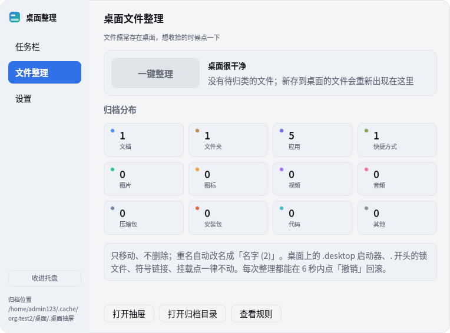
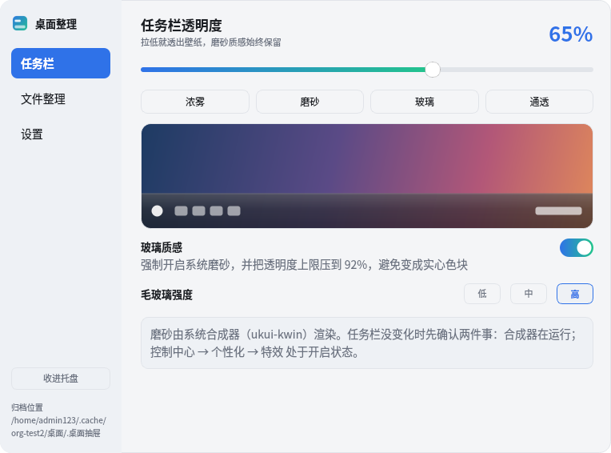
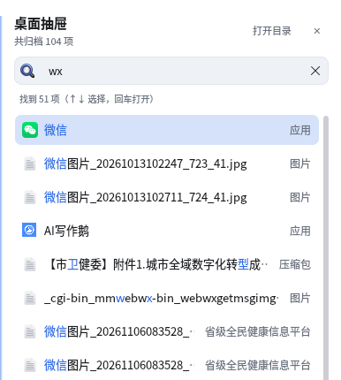
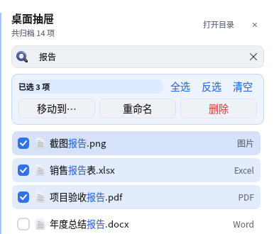
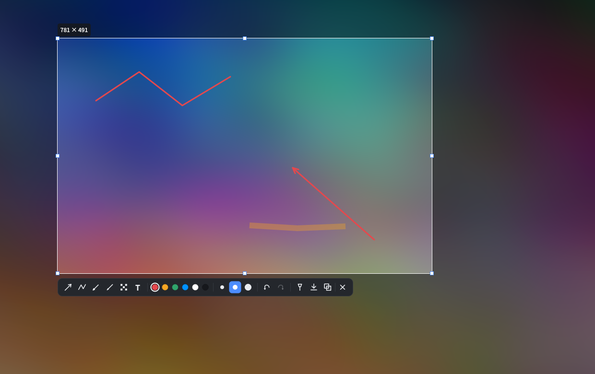
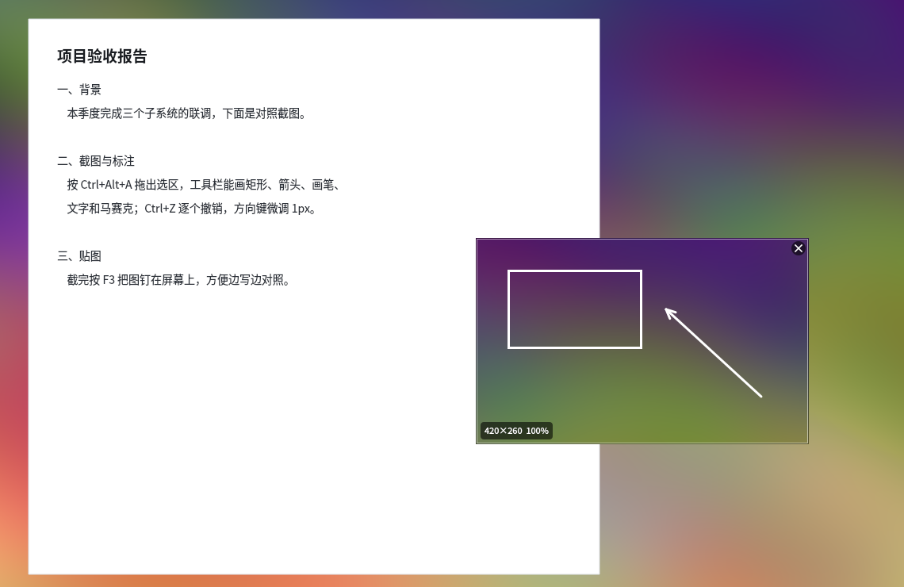

# 桌面整理 · Desktop Organizer

一个托盘小工具，干三件事：**把任务栏调成毛玻璃**、**一键把桌面文件收进抽屉**、**截屏加标注并贴到屏幕上**。
外带一个从屏幕右边缘滑出的抽屉，带模糊搜索（支持拼音首字母）和批量处理。

一套代码，两个平台：**银河麒麟 V10（UKUI）** 与 **Windows 10/11**。



---

## 功能

### 1. 任务栏外观

**麒麟**：滑块 0–100%，写 `gsettings`，**背景真透明、图标清晰**，改完立刻生效。

**Windows**：两种形态，二选一（互斥，切换时自动把另一种摘干净）

| 形态 | 效果 | 代价 |
|---|---|---|
| **自动隐藏**（推荐） | 整条让位给壁纸，鼠标碰底边才滑出来 | 无，图标零损失，系统原生、随时可逆 |
| **整窗淡出**（55%–100%） | 能透出桌面 | 图标与文字等比一起变淡 |

- 四档预设：浓雾 / 磨砂 / 玻璃 / 通透
- 实时预览卡：把"任务栏叠在壁纸上"的样子画出来，拖滑块即时可见
- 检测到 TranslucentTB 正在运行时会给出提示：两者改的是同一块任务栏，同时开启会互相覆盖

> **为什么 Windows 上纯外部程序做不到「背景透、图标清晰」**
>
> 读过 TranslucentTB 的源码（`ExplorerTAP/taskbarappearanceservice.cpp`）：
> 它注入 explorer 后，拿到任务栏背景那个 XAML `Shape`，直接 `Fill(newBrush)` 换掉画刷，
> 并 `SetWindowSubclass` 任务栏窗口在 `WM_PAINT` 里涂黑客户区。这些动作全部发生在
> **explorer 进程内部**，外部调用 `SetWindowCompositionAttribute` 完全没有机会参与。
> 它是签过名的开源项目（`ExplorerTAP` + `ExplorerHooks` 两个注入 DLL），所以杀软不拦；
> 纯 Python 复刻不了这条路径（要 C++ DLL + COM proxy/stub + WinRT XAML 访问 + 代码签名）。
>
> Win11 10.0.26200（25H2）实测，外部能试的路全部无效 —— 取样任务栏
> 2560×60 物理像素，用均亮度 / 标准差 / 图标对比度三个指标卡：
>
> | 尝试 | 结果 |
> |---|---|
> | `SetWindowCompositionAttribute`：AccentState 0~5 × alpha 0/128/255 | 仅 state 2 拉动 4 级（37.32→41.57），其余零变化 |
> | `DwmSetWindowAttribute(DWMWA_SYSTEMBACKDROP_TYPE = 2/3/4)` | HRESULT=0，零变化 |
> | `DwmEnableBlurBehindWindow` | 38.09 → 39.68，噪声级 |
> | 注册表 `TaskbarAcrylicOpacity`（0 / 200，各重启一次 explorer） | 零变化 |
> | 色键透明（`WS_EX_LAYERED` + `LWA_COLORKEY`） | 零变化，DComp 内容不走重定向表面 |
> | 隐藏 XAML 子窗口 `DesktopWindowContentBridge` | 整条变纯色 103、标准差 0.00、图标对比度 0.0 |
>
> 最后一行是关键：图标和背景在**同一个视觉树**里，隐藏背景层连图标一起消失，
> 所以"只摘背景"这条路从进程外不存在。
>
> **AccentState 常量容易记错**（TranslucentTB 的 `Common/undoc/user32.hpp`）：
> `1 = GRADIENT`（alpha 被忽略）、`2 = TRANSPARENTGRADIENT`（Clear，用 alpha）、
> `3 = BLURBEHIND`、`4 = ACRYLICBLURBEHIND`。网上很多资料把 2 写成 blur，会试错一轮。
>
> 另外两条实测数据，供判断"淡出"值不值：
>
> | 不透明度 | 任务栏背景亮度 | 图标对比度 |
> |---|---|---|
> | 100%（系统原样） | 37.3 | 31.0 |
> | 80% | 33.5 | 24.2 |
> | 55%（下限） | 约 24 | 约 21 |
>
> 图标掉约三成、背景只透出一点点 —— 所以把自动隐藏放在前面推荐。



### 2. 桌面文件一键整理

文件照常存桌面，想收拾的时候点一下：

```
桌面 → 点「一键整理」 → 按类型归到 桌面/.桌面抽屉/ → 结果条 + 撤销
```

- 四个入口：主窗口大按钮 / 托盘右键 / 抽屉顶部 / 命令行 `tidy`
- **不弹确认框**，安全靠"可撤销"：结果条 6 秒后自动收起，撤销入口一直在
  （抽屉底部 / 托盘菜单 / `zhengli undo`）
- 「自动整理新文件」默认**关闭**，你想收拾了才点

### 3. 右侧滑出抽屉（应用 / 文件两页）

屏幕右边缘一条 11px 的小竖条，点一下往左滑出抽屉。左侧是竖排的两页切换：

| 页 | 内容 |
|---|---|
| **应用** | 抽屉里的快捷方式（`.lnk` / `.url` / `.desktop`）和「此电脑 / 回收站 / 用户文件夹」平铺成图标网格，**单击直接启动** |
| **文件** | 文档 / 文件夹 / 图片… 按分类折叠。点分类行**直接平铺出所有文件名**，点子分类名只做标签（右侧灰字），点文件名就用默认程序打开——不用再点进 Word/Excel 那层文件夹找 |


搜索框只在「文件」页出现，支持中文、拼音首字母、文件名、扩展名（切回应用页会自动清空，免得结果盖住图标）：

| 输入 | 命中 |
|---|---|
| `报告` | 文件名含「报告」的 |
| `wx` | 微信（拼音首字母） |
| `sls` | 商洛市… |
| `wechat` | 按文件名也能搜 |
| `doc` | 扩展名也算文件名的一部分 |



### 4. 搜到了就顺手处理掉

搜索不只是"看见"，勾上就能动：**移动到别的文件夹 / 统一重命名 / 删除进回收站**。



点搜索结果左边的勾选框选中（点名字仍然是打开文件），选中 1 项以上时浮出操作栏：

| 动作 | 做什么 |
|---|---|
| **移动到…** | 搬进抽屉里任意分类或子目录、当场新建一个文件夹、或另选别的位置 |
| **重命名** | 把文件名里的某个词统一换掉，带实时预览 |
| **删除** | 放进系统回收站（不是 `rm`），先弹确认框 |

三个动作**都能撤销**：点抽屉底部「撤销上次」，或终端 `zhengli undo`。

### 5. 截图与贴图

快捷键照 Snipaste 那套：

| 键 | 干什么 |
|---|---|
| `F1` | 截屏（进标注界面） |
| `F2` | 截屏并自动复制（框完直接进剪贴板，不进标注） |
| `Shift+F1` | 自定义截屏（先定尺寸，再拖着框定位） |
| `F3` | 把剪贴板里的图贴到屏幕上 |
| `Shift+F3` | 隐藏 / 显示所有贴图 |



- **八种标注**：方框、圆形（`Shift` 出正方 / 正圆）、箭头、折线、画笔、记号笔（荧光笔）、马赛克、文字；`Ctrl+Z` 撤销、`Ctrl+Y` 重做
- **像素级对齐**：拖选时鼠标旁边有 4 倍放大镜 + 坐标，框定后用方向键微调 1px（`Shift` 10px）
- **贴图**：钉在屏幕上当参考图，**落在原截图的位置**，鼠标拖边角缩放（拖角锁比例）、滚轮缩放、`Ctrl+滚轮`调透明度
- **一键让路**：设置里可以整体关掉这组快捷键，把 F1/F2/F3 还给别的程序



## 平台支持

| 能力 | 麒麟 V10 SP1（UKUI） | Windows 11（10.0.26200） |
|---|---|---|
| 任务栏透明度 | `gsettings` 三键（0~100%），背景真透明图标清晰 | 自动隐藏（推荐）或整窗淡出 55%~100%；Win10 走 accent，可做到背景透、图标清晰 |
| 桌面文件整理 | ✅ 已实测 | 逻辑平台无关，自检通过（未做真实整理） |
| 抽屉 / 搜索 / 托盘 | ✅ 已实测 | 托盘可用性自检通过 |
| 桌面图标（应用） | `.desktop` | `.lnk` / `.url`（图标读取已实测） |
| 公共桌面快捷方式 | 不适用（只有一个桌面） | **默认纳入**；该目录只给删除权限，撤销时退回你的桌面 |
| 系统图标（此电脑/回收站） | peony 三个 gsettings 键 | `HideDesktopIcons` 注册表（读取已实测） |
| 开机自启 | `~/.config/autostart/*.desktop` | `HKCU\...\Run` 读写已实测 |
| 截图与贴图 | ✅ 已实测（Qt 抓屏 + X11 热键） | 全局热键注册已实测（Ctrl+Alt+G） |

> **关于 Windows 版**：已在 Windows 11（内部版本 26200）+ Python 3.13 + PyQt 5.15.11
> 上跑过 [`tools/selftest_win.py`](tools/selftest_win.py)，**12/12 项全部通过**：
> 任务栏窗口、亚克力 API 与贴附、注册表读写、托盘、`.lnk` 图标、热键注册都正常。
> 换其它 Windows 版本后仍建议跑一次自检，把生成的 `selftest.txt` 贴到 issue 里。

## 快速开始

从 GitHub 下载后，先按你的情况选一条路：

| 你的情况 | 走哪条 |
|---|---|
| 不想装 Python / 只想双击就用 | **下载 Release 里的 `DesktopOrganizer.exe`**，跳过下面所有步骤 |
| 有 Python，想改代码或跑最新版 | 源码运行 / 装到系统（下方） |
| 麒麟 V10 / Linux | 看下方「麒麟」一节 |

### Windows（源码运行）

需要 Python 3.8+ 和 PyQt5：

```bat
pip install -r requirements.txt
```

- **直接跑**：双击 `run_windows.bat`
- **装到系统**（开始菜单快捷方式 + 可选开机自启）：

```bat
python install_windows.py
```

- **打包成 exe**（给没装 Python 的机器，需要 PyInstaller）：

```bat
build_windows.bat
```

卸载：`python uninstall_windows.py`（只删程序，已归档的文件不动）

> **PyQt5 下载慢 / 装不上怎么办**：PyQt5 的 Qt 运行库有 48MB，某些网络下 pip 会
> `IncompleteRead` 或超时。可以换国内源重试，例如华为源：
> `pip install -r requirements.txt -i https://repo.huaweicloud.com/repository/pypi/simple/`
> 或在浏览器里手动下载三个 wheel（`PyQt5`、`PyQt5-Qt5`、`pyqt5_sip`）后本地安装。

### exe（免 Python）

`dist/DesktopOrganizer.exe` 是约 39MB 的单文件，已经把 Python 和 PyQt 一起打进去了：
下载后**双击即用**，不需要装 Python、不需要 `pip install`。首次运行会在
`%APPDATA%\DesktopOrganizer` 生成配置文件。

> 注：`dist/` 在 `.gitignore` 里，不随源码仓库分发；exe 请从 Releases 页面下载。

### 麒麟 V10 / Linux

```bash
bash install.sh              # 装到 ~/.local/share/desktop-organizer
bash install.sh --autostart  # 顺带开机自启
zhengli                      # 启动，直接进托盘
```

依赖：系统自带的 `python3` + `python3-pyqt5`，无第三方包。

## 归类规则

归到桌面下的隐藏文件夹 `桌面/.桌面抽屉/`（Windows 是 `%USERPROFILE%\Desktop\.桌面抽屉`）：

```
├── 文档/    Word/ Excel/ PPT/ PDF/ 文本/
├── 文件夹/  桌面上的文件夹整包搬进来
├── 应用/    桌面图标背后的启动器（.desktop / .lnk / .url）
├── 图片/    照片、截图、位图素材，含 svg / ico / icns 图标
├── 视频/   音频/
├── 压缩包/  安装包/  代码/  其他/
```

| 分类 | 认这些 |
|---|---|
| 文档/Word | doc docx wps rtf odt dot docm |
| 文档/Excel | xls xlsx xlsm et csv ods |
| 文档/PPT | ppt pptx pps dps odp |
| 文档/PDF | pdf ofd xps |
| 文档/文本 | txt md log tex epub mobi |
| 图片 | jpg png bmp gif webp tif heic psd xcf raw…，**外加** svg svgz ico icns cur 图标 |
| 应用 | `.desktop`（麒麟）/ `.lnk` `.url`（Windows） |

**永不移动**：`.` 开头的锁文件（Office 的 `.~xxx.docx`）、`~$xxx.docx`（Office 打开文件时
生成的属主锁文件）、相对路径的符号链接、挂载点、`desktop.ini` / `Thumbs.db` 这类系统占位文件、
未下完的 `.part`，以及**程序自己所在的目录**（从桌面直接跑源码时，那个项目文件夹就是程序的家）。

补充：重名自动改名 `名字 (2).ext` 不覆盖；3 秒内刚写过的文件跳过；每次移动都记账，可按批撤销。

### 公共桌面（Windows）

Windows 会把「你的桌面」和「所有用户的桌面」（`C:\Users\Public\Desktop`）合并显示成一个桌面。
Office、微信、QQ、百度网盘、火绒这些「所有用户」安装的软件，图标大多放在后者 —— 只扫自己的桌面，
抽屉里就永远缺这一半。所以**默认纳入整理**。

需要知道的是那个目录的权限：系统的默认 ACL 给普通用户 `DE/DC`（删除、删子项），
**没给 `WD/AD`（写入、建文件）**。也就是说图标搬得出来、搬不回去 —— 这是权限模型的必然结果，
不是程序的 bug。所以程序改成：

- 照搬，把图标收进抽屉「应用」，桌面上就真的干净了
- 撤销时写不回公共桌面 → **自动放回你自己的桌面**（`%USERPROFILE%\Desktop`），并明说一句
- 只影响本机其它账号的桌面（单机用户无感）；软件升级重装可能重新生成快捷方式，再整理一次即可

不想要这个行为，设置 → 关掉「整理公共桌面快捷方式」即可。

### 桌面图标怎么"进抽屉还能用"

桌面上的图标其实分三种，处理方式完全不同：

| 图标 | 本质 | 怎么处理 |
|---|---|---|
| 微信、WPS、Chrome、"快捷方式 - xxx"… | 快捷方式文件（`.desktop` / `.lnk` / `.url`） | 搬进「应用」，抽屉里变成可点磁贴 |
| 此电脑、回收站、主目录 | **不是文件**，系统画的虚拟图标 | 搬不走；用开关把桌面图标藏掉，抽屉里补等价磁贴 |

搬走仍然能启动，是因为**快捷方式能不能用跟它在哪个目录无关**——`.lnk` 记的是目标的绝对路径，
`.desktop` 靠 Exec 字段，两者都不依赖自身位置。

> **Windows 公共桌面**：Windows 把「你的桌面」(`%USERPROFILE%\Desktop`) 和
> 「公共桌面」(`C:\Users\Public\Desktop`) 合并显示成一个桌面。软件安装时放的快捷方式
> （微信、QQ、Office 等）大多在公共桌面，程序会**同时扫描这两处**，一起搬进同一个抽屉。
> 搬走公共桌面的图标后，本机**其它用户账号**也将看不到它们；软件升级可能重新生成，
> 届时再整理一次即可。撤销时若系统不允许写回公共桌面，图标会放回你自己的桌面。

## 抽屉与搜索

- **入口**：屏幕右边缘 11px 竖条（可关，只留托盘）
- **展开**：230ms 从右往左滑出；分类行点一下就地展开
- **应用类**：4 列图标网格，图标从系统实时取，点一下启动
- **收起**：点抽屉左边缘的把手（把手跟着抽屉走）、`ESC`、`✕`、点别处
- **搜索**：`↑↓` 选择、`回车` 打开、`ESC` 清空

搜索排序是调出来的：开头命中 > 中间命中 > 子序列 > 首字母；长文件名里的"巧合"
（比如 `_cgi-bin_mmwebwx-bin_...` 里的 `wx`）会被降权，深层文件排在顶层之后。

## 搜索之后的批量操作

搜索结果每行左边有一个勾选框。点勾选框是选中，点名字是打开文件——不会为了勾一下反而把文件打开了。
选中 1 项以上，搜索框下面浮出操作栏：`已选 N 项` + `全选 / 反选 / 清空` + 三个动作。

### 移动到


列出抽屉里全部 12 个分类及其子目录，**默认选中文件当前所在的目录**；底部三个出口：

- **新建文件夹**：在当前选中的目录下建，建完自动选中
- **其他位置…**：跳到系统文件夹选择器，可以搬到抽屉外面的任意路径
- **移动**：双击列表项也是直接移动

### 重命名


填「查找」和「替换为」，下面实时预览每一个文件会变成什么：旧名带删除线，新名用主题色标出。
**扩展名默认不动**（免得把 `.docx` 改名成 `.txt` 打不开），需要连扩展名一起改再勾那个复选框。
不含查找词的文件会标出来并跳过，不会算作失败。

### 删除


**进回收站，不是 `rm`。** 麒麟上按 freedesktop 规范写 `~/.local/share/Trash`（文件进 `files/`，
同时在 `info/` 写 `.trashinfo` 记录原位置），所以文件管理器的回收站里能正常看到，也能从那里还原。
勾选里含文件夹时会额外提示"会连同里面的内容一起进去"。

### 几个刻意的设计

| 设计 | 为什么 |
|---|---|
| **勾选跨搜索保留** | 搜「报告」勾几项，再搜「总结」勾几项，能一起删。操作栏会注明"其中 N 项不在此结果里"，不会误删看不见的东西 |
| **Shift 连选一段** | 一次勾一片，不用一个个点 |
| **归档骨架受保护** | 12 个分类目录、桌面目录本身不能删也不能移，否则抽屉结构就散了 |
| **不原地打转** | 目标就是文件当前所在目录时直接拦下，不会生成一个 `xxx (2).docx` |
| **重名不覆盖** | 移动/重命名遇到同名一律改名成 `名字 (2)` |
| **两套日志分开记** | 整理用 `moves.jsonl`（桌面→抽屉的单向搬运），批量操作用 `ops.jsonl`（任意方向的用户意图）。撤销时比较两个文件的修改时间，谁更新撤谁，所以界面上只有一个「撤销上次」 |

## 截图

### 四个入口

| 入口 | 怎么用 |
|---|---|
| **快捷键** | `F1` 截图 / `F2` 截图并复制 / `Shift+F1` 固定尺寸 |
| **托盘右键** | 前四项：截图 / 截图并复制 / 自定义截屏 / 贴图 |
| **主窗口** | 导航「截图」页 → 「开始截图」 |
| **命令行** | `zhengli snip`（主程序没在跑也能用）/ `zhengli snipcopy` |

截图开始时会**自动收起主窗口**，免得把自己截进去；按 `ESC` 取消会把窗口还回来。

### 框选

拖动鼠标框出一块区域，屏幕其余部分压暗、选区保持原亮度。选区四周有 8 个把手，
拖着可以调整；也可以在选区里按住拖动整体挪位置。

拖的时候鼠标旁边有一块 **4 倍放大镜 + 实时坐标**，用来对齐像素边界；
框定之后放大镜自动消失（不然挡视线）。

按钮栏浮在选区下方（下方空间不够就翻到上方），跟着选区走。

### 标注

| 工具 | 怎么用 |
|---|---|
| **箭头** | 从起点拖到终点，箭头跟着方向转 |
| **方框** | 拖出矩形，框住一块重点；按住 `Shift` 拖就是正方形 |
| **圆形** | 拖出椭圆（圈重点）；按住 `Shift` 拖就是正圆 |
| **折线** | 逐点点击定折点，双击 / 回车 / 右键收尾；ESC 丢掉这条 |
| **画笔** | 按住自由画，适合圈圈点点 |
| **记号笔** | 半透明粗线（荧光笔），压在文字上还能看清底下 |
| **马赛克** | 拖一片区域，从原图取样做方块化，用来遮敏感信息 |
| **文字** | 点一下出输入框，回车落字（带半透明黑底，深浅背景都看得清） |

八种工具、六种颜色（红橙绿蓝白黑）、三档线宽（工具条上用逐渐变粗的圆点表示），`Ctrl+Z` 撤销、`Ctrl+Y` 重做。

方框和圆形都是**空心描边**（不填色，压不住底下的内容）：拖的时候就能看到实时预览，松手落图；描边内缩半个线宽，整条线都落在你拖出来的框里，不会糊出去半根。
`Shift` 是**拖动过程中按下就生效**，松手前松开 `Shift` 会回到自由矩形——想画正方/正圆就在拖的时候一直按住。


工具条的图标是自己用 QPainter 画的，不依赖图标主题——换个精简的主题也不会变成一堆空方块。

### 输出

| 动作 | 快捷键 |
|---|---|
| 复制到剪贴板 | `Enter`（或双击选区 / 点「复制」） |
| 存盘 | `Ctrl+S`（或点「保存」，存到设置里的目录） |
| 贴到屏幕上 | `F3`（或点「贴图」，同时也会复制） |
| 整屏 | `Ctrl+A` |
| 撤销 / 重做标注 | `Ctrl+Z` / `Ctrl+Y` |
| 取消 | `ESC` |

设置页可以打开「截完自动复制」和「截完自动存盘」，那样框完松手就已经在剪贴板和文件夹里了。

文件名是 `截图_20261125_160503.png`，重名自动加序号，不会覆盖。

### 贴图

贴图是一个无边框、置顶的小窗口，**默认贴在刚截的那块位置**（不是屏幕中央），看起来就是那一片画面留在原地：

| 操作 | 效果 |
|---|---|
| 拖动 | 移到任意位置 |
| 拖四角 / 四边 | 缩放；**拖角默认锁比例**（图不变形），按住 `Shift` 拖角可自由拉伸 |
| 滚轮 | 缩放（24px ~ 4000px），以中心为锚点 |
| `Ctrl+滚轮` | 调透明度（15% ~ 100%） |
| 双击 | 在「100% 原图尺寸」和「铺到屏幕 80%」之间切换 |
| 悬停 | 四边四角出白色小方块（拖它缩放），右上角出关闭点，左下角显示尺寸 / 缩放比例 / 不透明度 |
| 右键 | 复制 / 另存为 / 还原为 100% / 三档不透明度 / 关闭 |
| `ESC` | 关闭 |

右上角那个 `×` 就是关闭按钮，所以**右上角不做缩放热区**；要放大往右下角或其它三条边拖。
贴图太小（任一边 < 56px）时不出缩放热区，免得太小点不准。

可以同时贴很多张。托盘菜单的「贴图剪贴板」（`Ctrl+Alt+V`）能把剪贴板里的图直接钉上来——
比如从网页复制的图、别处截的图。

### 快捷键总开关

F1 / F2 / F3 是全局抓的，会盖住别的程序：**浏览器的 F1 是帮助、F3 是查找下一个**。
所以给了个开关，位置有三处：

- 主窗口「截图」页 →「启用截图快捷键」
- 托盘右键 →「启用截图快捷键」
- 命令行 `zhengli snipkeys off` / `on`

关掉之后：

- 这四个键**完全不再抓取**（应用根本收不到它们，等于还给了系统）
- 热键注册会重建一次，`Ctrl+Alt+G`（任务栏材质）不受影响
- 截图功能本身还在——托盘菜单和主窗口按钮照样能用
- 设置页那行提示会变成「截图快捷键已关闭，F1 / F2 / F3 归还给其它程序」

> 为什么不做成"只放掉冲突的那一个"：X 的 key grab 是整键粒度，没法只让某个应用例外。
> 要么全抓、要么全放，开关做在这个粒度上才对得上实际行为。

### 关于抓屏

用的是 Qt 的 `QScreen.grabWindow(0)`，多屏时把每块屏拼成一张虚拟桌面画布，
坐标按设备像素统一处理（高分屏不会出现半像素错位）。

一个已知坑：**如果桌面特效关了，抓到的可能是一片黑**（没有合成器时只能拿到窗口内容，
拿不到桌面背景）。所以加了检测——整张图采样后是同一个颜色时会提示你去控制中心开启特效。

## 命令

麒麟 / Linux：

```bash
zhengli                 # 启动（默认进托盘）
zhengli show            # 唤出主窗口
zhengli tidy            # 一键整理
zhengli scan            # 预览会怎么归，不移动
zhengli undo            # 撤销上一次操作（整理或批量改动）
zhengli snip            # 截图（主程序没在跑也能用）
zhengli snipcopy        # 截图并直接复制
zhengli pin             # 把剪贴板里的图钉到屏幕上
zhengli snipkeys off    # 关掉截图快捷键，把 F1/F2/F3 还给别的程序
zhengli stat            # 两个模块的状态一起看
zhengli panel 55        # 任务栏透明度 55%
zhengli glass on|off    # 玻璃质感开关
zhengli autostart on|off
zhengli diagnose        # 环境诊断
```

Windows 把 `zhengli` 换成 `python app\cli.py`，例如 `python app\cli.py tidy`。

## 实现说明：两个平台差在哪

差异全部收在 `app/sysenv.py`、`app/panel_core.py`、`app/panel_win.py`、`app/launchers.py` 四个文件里，
UI（`ui_main.py` / `ui_drawer.py`）完全平台无关。

| 关注点 | 麒麟 | Windows |
|---|---|---|
| 任务栏透明度 | `org.ukui.control-center.personalise:transparency`（0~1），写入实时生效 | 形态二选一：`SHAppBarMessage(ABM_SETSTATE)` 自动隐藏，或 `WS_EX_LAYERED` + `SetLayeredWindowAttributes` 整窗 alpha（140~255）；Win10 另有 `ACCENT_POLICY` 的 alpha（0~255） |
| 磨砂强度 | `personalise:blurry` 有低/中/高三档 | 无对应概念，该行控件在 Windows 上自动隐藏 |
| 玻璃质感开关 | `effect=true`、`enabled-global-blur=true`、`blurry` 三项每次重写 | **自动隐藏**：任务栏的磨砂由系统「透明效果」统一控制，这个开关按了没有可见变化 |
| 任务栏窗口 | QML 面板，改键即刷新 | `Shell_TrayWnd` + `Shell_SecondaryTrayWnd`；资源管理器重启后句柄失效，句柄变了重设，layered 位被冲掉也补回 |
| 启动应用 | `Gio.DesktopAppInfo`（处理 `%U`、`Terminal=true`） | `os.startfile` |
| 取图标 | `.desktop` 的 `Icon` 字段（主题名或绝对路径） | `QFileIconProvider`（读 shell 图标） |
| 隐藏判定 | 点开头 | 点开头 + `FILE_ATTRIBUTE_HIDDEN/SYSTEM` |
| 全局快捷键 | X11 `XGrabKey` + `QSocketNotifier` | `RegisterHotKey` + `QAbstractNativeEventFilter` |

**为什么 Windows 只能整窗淡出**：`SetWindowCompositionAttribute` 长期被当成
"任务栏透明"的正解（TranslucentTB 早期确实这么干），但在 Win11 10.0.26200 上
它打不穿 XAML 层 —— state 1/2/3/4/5 配任意 alpha，背景亮度只动 1~2 级；
`DWMWA_SYSTEMBACKDROP_TYPE` 和注册表 `TaskbarAcrylicOpacity` 同样无效。

所以 Win11 给了两种形态，都不碰背景本身：
**自动隐藏**（`ABM_SETSTATE`，整条让位给壁纸，图标零损失，实测即时生效、可逆）和
**整窗淡出**（`WS_EX_LAYERED` + `SetLayeredWindowAttributes`，线性可逆、退出时把扩展样式
原样还回去；代价是图标文字等比变淡，下限因此设在 55%）。两者互斥，切换时自动摘干净另一种。
Win10（build < 22000）保留 accent 分支，那边 alpha 真的有效，只压背景不动图标。

## 验证情况

**麒麟 V10 SP1 上实测过的**：

| 项目 | 结果 |
|---|---|
| 透明度写入 | 68% → 系统值 0.68，实时生效不用重启任务栏 |
| 玻璃质感封顶 | 拉 100% 被压到 **92%**，且 `blurry/effect/enabled-global-blur` 每次重写 |
| 一键整理 | 20 项归类（18 应用 + 2 快捷方式），统计/结果条/托盘提示同步 |
| 撤销 | 20 项全部还原 |
| 搬走仍可启动 | 移入隐藏目录后 `launch()` 返回 True |
| 搜索 | `wx`→微信、`sls`→商洛市、`报告`→7 条；↑↓/回车/ESC 正常 |
| 批量移动 | 勾 2 项 → 选目录 → 到位 → 撤销复原 |
| 批量重命名 | 5 个文件里 4 个含「报告」全部替换，1 个自动跳过；撤销复原 |
| 批量删除 | 2 项进回收站（`files/` + `.trashinfo` 齐全），撤销精确移回原位 |
| 边界拦截 | 删分类根目录、移动到当前目录，都被明确拦下并给出原因 |
| 跨搜索勾选 | 两个搜索词各勾 1 项，操作栏提示"其中 1 项不在此结果里" |
| 跳过规则 | 锁文件、相对链接、挂载点均未动 |
| 框选截图 | 拖选 641×441，选区外压暗、8 个把手、尺寸提示正确 |
| 标注 | 方框/圆形/箭头/画笔/文字/马赛克都落到导出图里，`Ctrl+Z` 逐个撤销 |
| 方框·圆形 | 空心描边、不填色；`Shift` 拖出正方形/正圆（四象限方向都对），描边内缩半个线宽不出框 |
| 键盘 | 方向键 1px、`Shift`+方向键 10px，选区与内部坐标同步 |
| 输出 | `Enter` 复制（尺寸与选区一致）、`Ctrl+S` 存盘、`F3` 贴图、`ESC` 取消 |
| 贴图 | 拖动/缩放（420×260 → 630×390）/透明度 0.6，关闭后从列表移除 |
| 六热键 | `F1` / `F2` / `Shift+F1` / `F3` / `Shift+F3` / `Ctrl+Alt+G` 六个键各自独立触发，互不串 |
| 快捷键开关 | 关掉后只剩 `Ctrl+Alt+G` 被占用，按 F1 不再弹截图；再打开立刻恢复 |
| 截屏并复制 | `F2` 框完直接进剪贴板（561×441），不进标注界面 |
| 固定尺寸 | `Shift+F1` 定 400×300，选区恒为 400×300，跟着鼠标定位 |
| 折线 / 记号笔 | 折线 3 个折点正确落图；记号笔存成 `marker` 类型、半透明粗线 |
| 撤销重做 | 画 2 笔 → undo 剩 1 → redo 回到 2，重做链在画新笔时清空 |

**Windows 上已在 Windows 11（10.0.26200）实测**：自检 12/12 项通过，覆盖 Python/PyQt 版本、
桌面目录、配置目录可写、注册表读写、任务栏窗口、亚克力 API、实际贴亚克力（60% / 88% 均成功并自动恢复）、
桌面文件盘点、`.lnk` 图标、系统托盘、全局热键（Ctrl+Alt+G）、系统图标开关读取。
未覆盖的真实操作：一键整理的真实搬运、批量删除进回收站、截图框选的实际交互（这些逻辑平台无关）。

任务栏透明度的逐档像素实测（取样任务栏中段 800×30 区域的平均亮度，壁纸为浅色）：

| 滑块 | 10% | 28% | 52% | 72% | 90% | 100% |
|---|---|---|---|---|---|---|
| 实测亮度 | 51.6 | 86.1 | 132.1 | 168.9 | 201.0 | 217.5 |

单调、近似线性；滑块拖到 0 会被夹到 10%，界面数字同步显示 10%（不会出现"数字 0 但滑块停在 10"）。
退出时扩展样式精确还原：`0x00000088` → 加 layered 变成 `0x00080088` → restore 回到 `0x00000088`。

> **v1.0.1 的加固**（来自实际踩到的坑）：公共桌面默认不纳入整理；搬运"非用户桌面"的目录前
> 先写一个临时文件探一次写权限，探不通就整批跳过并逐条提示；程序自己所在的目录永不搬
> （从桌面跑源码时，项目文件夹就是它的家）；`~$xxx.docx` 这类 Office 锁文件不再被当普通文档归类。
> 任务栏页的文案也按平台分开了——Windows 上不再显示 ukui-kwin 的排查指引。

> **v1.0.2 修的是"透明度调节不起作用"**：旧实现把 alpha 映射成亚克力 `GradientColor`
> 的 RGB 明度，但 Win11 26200 上那个颜色贴到任务栏只能拉动 23 级灰度，拖滑块几乎没反应。
> 现在改成 layered 窗口 + `SetLayeredWindowAttributes`，10%–100% 全程可调、线性、可逆。
> 顺带：Windows 上那个按了没有可见变化的「玻璃质感」开关自动隐藏；滑块范围和显示值
> 跟着后端真实上下限走，不会再出现"数字 0% 但滑块停在 10%"。

> **v1.0.4 把这件事查到底了**：读 TranslucentTB 源码确认，它的真透明是在 explorer
> 进程内换掉任务栏背景 XAML `Shape` 的 `Fill`，外部 API 够不着。所以 Windows 侧改成
> 两种形态二选一 —— 新增「自动隐藏」（`ABM_SETSTATE`，图标零损失），保留「整窗淡出」，
> 并检测 TranslucentTB 等第三方工具避免互相覆盖。测量方法也修了：之前有几个实验脚本
> 没做 DPI 感知，取样落在了壁纸上，读数当然不动；对齐物理像素后数据才可信。

> **v1.0.5：公共桌面的图标终于收得进来了**。以前「公共桌面默认不整理」是上一个版本
> 为防事故做的保守选择（那个目录"删得掉、写不回"，一度让 20 个图标卡在抽屉里）。
> 这次换了做法而不是把风险留在那儿：**照搬，但把撤销目标记成用户自己的桌面**。
> 权限事实（`icacls C:\Users\Public\Desktop` → `Admin:(OI)(CI)(IO)(DE,DC)`）说明
> 搬出来只需要 `DELETE`，搬回去才需要 `WRITE_DAC`/`ADD_FILE` —— 程序在搬运时探一次，
> 探不通就把 `restore_dir` 一起记进撤销日志，撤销时改道放回用户桌面并明说一句。
> 老配置用 `cfg_ver` 迁移一次（那个 `0` 是当年的默认值、不是用户的选择），
> 设置页开关仍可随时关掉。

## 已知限制

1. **Windows 的"整窗淡出"会连图标文字一起变淡**（整窗混合的必然结果），下限 55%；
   想要"背景透、图标实"，请用自动隐藏，或者装 TranslucentTB —— 它靠注入 explorer 实现，
   本工具不注入。
2. Windows 没有"磨砂强度"分级，也没有可用的"玻璃质感"开关（按了没有可见变化），这两行控件会自动隐藏。
3. 文件分类靠扩展名，改了后缀会归错（文件夹按目录判断，快捷方式按类型判断，不受影响）。
4. 「此电脑 / 回收站 / 主目录」不是文件，只能靠系统开关隐藏，无法真正归档。
5. 桌面上若有链接指向被搬走的文件夹，链接会失效（链接本身不移动）。
6. 相对路径的符号链接永远不移动。
7. **截图只覆盖鼠标所在的那块屏幕**。多屏时不能跨屏拖一个选区——真要做需要多窗口联动，复杂度不值得。
8. **桌面特效关闭时截出来可能是黑的**（拿不到桌面背景）。程序会提示，但不会替你打开特效。
9. 截图复制到剪贴板依赖系统的剪贴板管理器（麒麟自带）。如果主程序退出后剪贴板内容消失，说明系统没有常驻管理器。
10. **Windows 做不到"只透背景"**：任务栏背景和图标在 explorer 的同一个 XAML 视觉树里，
    外部程序改不动（实测隐藏背景层连图标一起消失）。可用手段只有自动隐藏与整窗淡出两种。
11. **公共桌面（`C:\Users\Public\Desktop`）默认纳入整理**，但那个目录只给了删除权限、没给写入权限：
    撤销时图标会放回你自己的桌面，而不是公共桌面（要真的写回公共桌面，需要管理员）。
    设 置 里关掉「整理公共桌面快捷方式」可以恢复"只整理自己的桌面"。

## 开发

改完逻辑先跑一遍纯逻辑测试——**不需要 PyQt5，也不会碰你的真实桌面**（全部在临时目录里跑，
撤销日志也重定向了）：

```bash
python -m unittest discover -s tests -v
```

覆盖：分类规则与跳过规则（含 Office 锁文件）、搬运不覆盖重名、整理→撤销往返、预览与执行口径一致、
只读目录跳过、日志裁剪、批量改名撤销、搜索排序。

Windows 真机再补一次自检（会短暂贴一次任务栏并自动恢复）：

```bat
python tools\selftest_win.py
```

## License

[MIT](LICENSE)

---

<details>
<summary><b>English summary</b></summary>

A small tray utility for **Kylin V10 (UKUI)** and **Windows 10/11** that does three things:

1. **Frosted-glass taskbar** — adjustable opacity with the glass effect always preserved
   (capped at 92% so it never turns into a solid color block).
   On Kylin it drives `org.ukui.control-center.personalise` gsettings; on Windows it uses
   the undocumented `SetWindowCompositionAttribute` acrylic API (same approach as TranslucentTB).
2. **One-click desktop cleanup** — files stay on the desktop until you press the button,
   then get sorted into a hidden `.桌面抽屉` folder by type. Every move is logged and reversible.

3. **Screenshot & pin** — `F1` to drag-select (F2 = copy directly), annotate with rectangle /
   circle / arrow / polyline / pen / marker / mosaic / text, then copy, save, or pin the shot on
   screen as a floating reference (scroll to scale, Ctrl+scroll for opacity).

Plus a slide-out drawer on the right screen edge with fuzzy search (supports Chinese pinyin
initials) and clickable app icons. Search results are selectable: move several files into any
drawer folder (or a new one), batch-rename by find/replace with live preview, or send them to
the system trash — all reversible with one Undo.

**Install**: grab the standalone `DesktopOrganizer.exe` (~39 MB, Python included —
no setup needed) from Releases, or run from source with Python 3.8+ and PyQt5
(`pip install -r requirements.txt`). On Kylin: `bash install.sh`.

Windows support was **verified on Windows 11 (build 26200)**: the self-test
(`python tools/selftest_win.py`) passed 12/12 checks, including acrylic taskbar,
registry, tray, icons and hotkeys. Run it on other Windows builds too and share the
generated `selftest.txt`. The UI is Chinese only.

</details>
